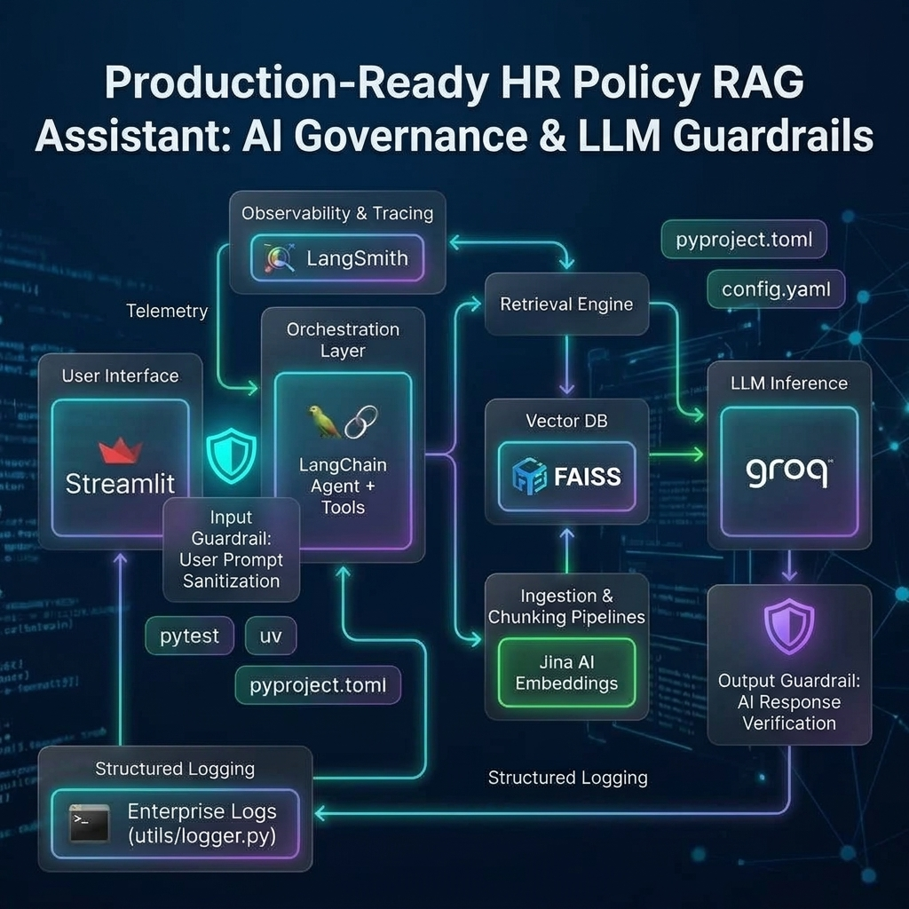

# 🏢 HR Policy RAG Assistant

An enterprise-ready **Retrieval-Augmented Generation (RAG)** assistant built with **LangChain**, **Qdrant Cloud**, **Jina AI Embeddings**, **Portkey AI Gateway**, **Groq LLM**, **openevals**, and **Streamlit** to deliver fast, secure, and hallucination-free answers over company HR policy documents.



---

## 📌 Key Features

* **📄 Document Ingestion & Chunking:** Parses HR policy documents into semantically coherent segments (`chunk_size=500`, `chunk_overlap=50`).
* **🧠 Semantic Embeddings:** State-of-the-art dense representations via **Jina AI Embeddings v2** (`jina-embeddings-v2-base-en`).
* **☁️ Cloud Vector Storage:** Scalable, cloud-persisted vector similarity search powered by **Qdrant Cloud** (migrated from local FAISS).
* **🌐 Resilient AI Gateway:** **Portkey AI Gateway** with virtual keys (`@hrpolicy`, `@hrpolicyfallback`) and automatic cross-account fallback to overcome rate limits and single-point-of-failure risks.
* **🛡️ Multi-Layer Guardrails:** Independent guardrail LLM checking for prompt injections, PII leaks, unauthorized promises, and system prompt tampering.
* **📊 Automated LLM Evaluations:** Systematic evaluation suite using **LangSmith Datasets & Experiments** with **openevals** (LLM-as-judge scoring **Correctness** and **Groundedness** across separate Groq accounts to avoid rate limits).
* **🔍 Full Observability:** Seamless end-to-end tracing in **LangSmith** for latency, token consumption, and tool trajectory analytics.
* **💻 Modern Web & CLI Interfaces:** Sleek **Streamlit** dark-themed web application and lightweight CLI interfaces.
* **🧪 Robust Test Suite:** 45 automated unit tests with mocked external APIs ensuring 100% CI pass rate.

---

## 📂 Project Structure

```text
hr-policy-rag-assistant/
├── Basic_RAG_experimental/       # Prototyping & experimental notebooks
├── Production_RAG/               # Production RAG service
│   ├── app.py                    # Streamlit Web UI entry point
│   ├── main.py                   # CLI conversation runner
│   ├── evaluate_pipeline.py      # Automated LangSmith evaluation runner
│   ├── pipeline.py               # End-to-end RAG pipeline orchestrator
│   ├── config.py                 # Centralized configuration & environment loader
│   ├── agent/
│   │   └── agent.py              # ReAct agent builder
│   ├── tools/
│   │   └── tools.py              # Policy retriever tool definitions
│   ├── ingestion/
│   │   └── loader.py             # Document loader
│   ├── chunking/
│   │   └── chunker.py            # Recursive character chunker
│   ├── embeddings/
│   │   └── embedder.py           # Jina AI embeddings wrapper
│   ├── vectordb/
│   │   └── vector_store.py       # Qdrant Cloud collection management
│   ├── retrieval/
│   │   └── retriever.py          # Vector store retriever setup
│   ├── llm/
│   │   └── llm_client.py         # Main LLM client via Portkey Gateway
│   ├── llm_gateway/
│   │   └── gateway.py            # Portkey AI Gateway routing & fallback setup
│   ├── llm_guard/
│   │   └── guardrails.py         # Input and output safety guardrails
│   ├── evaluation/
│   │   └── evaluations.py        # LangSmith dataset & openevals LLM-as-judge suite
│   ├── prompts/
│   │   └── prompt_templates.py   # Agent system instructions
│   ├── utils/
│   │   ├── logger.py             # Timestamped file & console logging
│   │   └── tracing.py            # LangSmith tracing initialization
│   ├── data/
│   │   └── hr_policies.txt       # Vertexon Solutions company policy document
│   ├── tests/                    # 45 Pytest unit tests
│   ├── pyproject.toml            # Python packaging & uv dependency manifest
│   └── .env.example              # Environment variables template
├── docs/                         # Architecture deep-dive documentation
│   ├── 01_logger.md              # Centralized logging setup
│   ├── 02_langsmith.md           # LangSmith observability & tracing
│   ├── 03_prompt_injections.md   # Security guardrails & red-teaming
│   ├── 04_local_to_cloud_vector_store.md # FAISS to Qdrant Cloud migration
│   ├── 05_llm_gateway.md         # Portkey AI Gateway & automatic fallback
│   └── 06_evaluations.md         # LangSmith evaluation & LLM-as-judge
└── README.md                     # Project overview
```

---

## 🚀 Quick Start

### Prerequisites
* **Python 3.10+** (Tested on Python 3.14.6)
* API Key for **Groq** ([console.groq.com](https://console.groq.com))
* API Key for **Jina AI** ([jina.ai](https://jina.ai))
* Free Cluster & API Key for **Qdrant Cloud** ([cloud.qdrant.io](https://cloud.qdrant.io))
* API Key for **Portkey AI** ([app.portkey.ai](https://app.portkey.ai))
* API Key for **LangSmith** ([smith.langchain.com](https://smith.langchain.com))

### 1. Clone the Repository
```bash
git clone https://github.com/narendhar11/hr-policy-rag-assistant.git
cd hr-policy-rag-assistant/Production_RAG
```

### 2. Install Dependencies

Using `uv` (recommended) or standard `pip`:

```bash
# Using uv:
uv sync

# Or using standard pip:
python3 -m venv .venv
source .venv/bin/activate
pip install -e .
```

### 3. Configure Environment Variables
Copy `.env.example` to `.env`:
```bash
cp .env.example .env
```

Populate the required credentials in `Production_RAG/.env`:
```env
# Groq LLM
GROQ_API_KEY=your_groq_api_key_here
GROQ_MODEL=openai/gpt-oss-20b

# Jina AI Embeddings
JINA_API_KEY=your_jina_api_key_here

# Qdrant Cloud Vector Store
QDRANT_URL=https://your-cluster-id.cloud.qdrant.io:6333
QDRANT_API_KEY=your_qdrant_api_key_here
QDRANT_COLLECTION_NAME=hr_policy_collection

# Portkey AI Gateway
PORTKEY_API_KEY=your_portkey_api_key_here
PORTKEY_CONFIG_SLUG=pc-your-main-config-slug
PORTKEY_GUARD_CONFIG_SLUG=pc-your-guard-config-slug

# LangSmith Observability & Evaluations
LANGSMITH_TRACING=true
LANGSMITH_ENDPOINT=https://api.smith.langchain.com
LANGSMITH_API_KEY=your_langsmith_api_key_here
LANGSMITH_PROJECT=hr-policy-rag
```

### 4. Run the Application

#### Web UI (Streamlit)
```bash
uv run streamlit run app.py
```

#### CLI Mode
```bash
uv run python main.py
```

#### Automated Evaluation Suite
Run regression tests and upload scored experiments to LangSmith:
```bash
uv run python evaluate_pipeline.py
```

---

## 🎯 Automated Evaluations (LangSmith + openevals)

Our evaluation framework ensures answer quality across every prompt, retriever, or model iteration:

```
LangSmith Dataset ("hr-policy-evaluations")
        │
        ▼
   target(): Real Agent Execution
   ├── Input & Output Guardrails (Groq @hrpolicy)
   └── Main LLM Tool Synthesis (Groq @hrpolicy)
        │
        ▼
   LLM-as-Judge Evaluators (openevals via Portkey)
   └── Frontier Judge Model: openai/gpt-oss-120b (Decoupled Portkey Route)
        ├── 1. Correctness (Matches Ground-Truth Reference)
        └── 2. Groundedness (Faithful to Qdrant Context Chunks)
        │
        ▼
   LangSmith Experiment Dashboard (Scored Metrics & Hallucination Diagnostics)
```

* **Correctness:** Verifies the answer against ground-truth company HR policy.
* **Groundedness:** Verifies that claims are strictly grounded in retrieved context chunks, catching hallucinations that reference-only checks miss.
* **Cross-Provider Evaluation:** Decoupling the evaluation judge from application inference via Portkey eliminates rate-limit bottlenecks and prevents self-evaluation bias.

---

## ⚙️ Configuration Reference

All settings in [`Production_RAG/config.py`](Production_RAG/config.py) can be customized via `.env`:

| Parameter | Environment Variable | Default Value | Description |
|---|---|---|---|
| `LLM_MODEL_NAME` | `GROQ_MODEL` | `openai/gpt-oss-20b` | Primary generation model |
| `LLM_TEMPERATURE` | `LLM_TEMPERATURE` | `0.0` | Sampling temperature |
| `EMBEDDING_MODEL_NAME` | `EMBEDDING_MODEL` | `jina-embeddings-v2-base-en` | Jina embedding model |
| `CHUNK_SIZE` | `CHUNK_SIZE` | `500` | Text chunk character length |
| `CHUNK_OVERLAP` | `CHUNK_OVERLAP` | `50` | Overlap characters between chunks |
| `TOP_K_RESULTS` | `TOP_K_RESULTS` | `3` | Retrieved context chunks passed to agent |
| `QDRANT_COLLECTION_NAME` | `QDRANT_COLLECTION_NAME` | `hr_policy_collection` | Qdrant Cloud collection name |
| `PORTKEY_CONFIG_SLUG` | `PORTKEY_CONFIG_SLUG` | *(Required)* | Main LLM Portkey saved config |
| `PORTKEY_GUARD_CONFIG_SLUG` | `PORTKEY_GUARD_CONFIG_SLUG` | *(Required)* | Guardrail LLM Portkey saved config |
| `LANGSMITH_TRACING` | `LANGSMITH_TRACING` | `false` | Enable runtime tracing |

---

## 🧪 Testing

The test suite contains **45 unit tests** run with `pytest` (mocking external API calls):

```bash
cd Production_RAG
uv run pytest tests/ -v
```

**Test Coverage:**
* Document Ingestion (`test_ingestion.py`)
* Text Chunking (`test_chunking.py`)
* Qdrant Cloud Operations (`test_vectordb.py`)
* Retriever & Top-K Retrieval (`test_retrieval.py`)
* Tool Calling & Execution (`test_tools.py`)
* Guardrails & Injection Defense (`test_guardrails.py`)
* System Prompts Integrity (`test_prompts.py`)
* LangSmith Tracing Setup (`test_tracing.py`)
* Evaluation Suite & Dataset Idempotency (`test_evaluation.py`)
* Pipeline Smoke Tests (`test_pipeline.py`)

---

## 📚 Architectural Guides

Explore our detailed engineering walkthroughs:
* [01. Centralized Logging](docs/01_logger.md)
* [02. LangSmith Observability & Tracing](docs/02_langsmith.md)
* [03. Security Guardrails & Prompt Injection Defenses](docs/03_prompt_injections.md)
* [04. Migrating from Local FAISS to Qdrant Cloud](docs/04_local_to_cloud_vector_store.md)
* [05. Adding an LLM Gateway with Portkey AI](docs/05_llm_gateway.md)
* [06. Automated Evaluations & LLM-as-Judge](docs/06_evaluations.md)

---

## 📜 License

Distributed under the MIT License.
