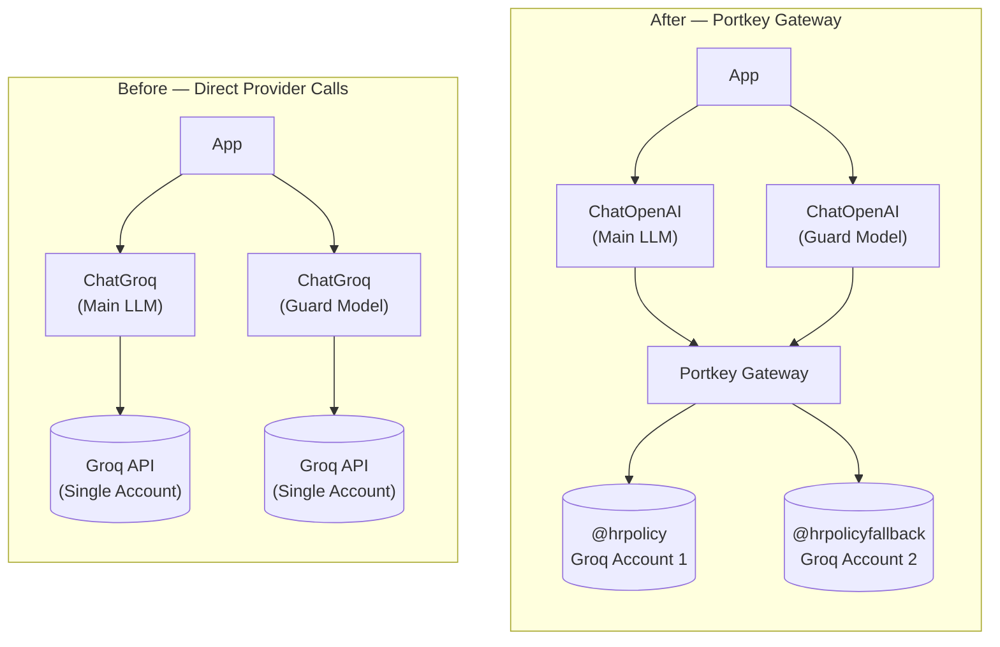

# 05. Adding an LLM Gateway with Portkey AI

**Branch:** `llm-gateway`

## Why add an LLM Gateway?

Calling LLM providers directly (e.g., Groq) works in development, but breaks
down in production:

| Concern | Direct Provider Call | Portkey Gateway |
|---------|---------------------|-----------------|
| **Resilience** | Single point of failure — if Groq is down, your app is down | Automatic fallback to a backup provider/account |
| **Rate Limits** | One account's TPM limit is your ceiling | Load-balance across multiple accounts |
| **Observability** | Per-provider dashboards, fragmented view | Unified logging, token tracking, cost analytics |
| **Key Security** | API keys scattered in app code / env vars | Virtual keys managed centrally in the gateway |
| **Caching** | No built-in caching | Simple caching to reduce latency and cost |

In short: **direct provider calls are fine for prototyping; an LLM gateway is
built for production reliability.**

---

## What is Portkey?

Portkey is an **AI Gateway** that sits between your application and LLM
providers. It acts as a proxy that adds production features without changing
your LLM code:

- **Virtual Keys** — named references (`@hrpolicy`, `@hrpolicyfallback`) to
  provider credentials, so real API keys never leave Portkey
- **Saved Configs** — JSON configurations (identified by `pc-...` slugs)
  that define routing strategies like fallback, load balancing, and caching
- **Unified API** — Portkey exposes an OpenAI-compatible endpoint, so
  `ChatOpenAI` from LangChain works out of the box

---

## What changed in the codebase

### 1. New dependencies

```toml
# pyproject.toml
[project]
dependencies = [
    ...
    "portkey-ai>=1.0.0",
]
```

### 2. New environment variables

Four new variables are needed in your `.env` file:

```bash
# .env
PORTKEY_API_KEY=your-portkey-api-key
PORTKEY_CONFIG_SLUG=pc-your-main-config-slug
PORTKEY_GUARD_CONFIG_SLUG=pc-your-guard-config-slug
```

### 3. Config changes (`config.py`)

```diff
+# ── LLM Gateway (Portkey) ──────────────────────────────────────────────────────
+PORTKEY_API_KEY           = os.getenv("PORTKEY_API_KEY")
+PORTKEY_CONFIG_SLUG       = os.getenv("PORTKEY_CONFIG_SLUG")
+PORTKEY_GUARD_CONFIG_SLUG = os.getenv("PORTKEY_GUARD_CONFIG_SLUG")
```

### 4. New module: `llm_gateway/gateway.py`

This is the core of the gateway integration. Two functions route LLM calls
through Portkey using saved config slugs:

#### `get_gateway_llm()` — Main LLM

```python
from langchain_openai import ChatOpenAI
from portkey_ai import createHeaders, PORTKEY_GATEWAY_URL

def get_gateway_llm() -> ChatOpenAI:
    headers = createHeaders(
        api_key=config.PORTKEY_API_KEY,
        config=config.PORTKEY_CONFIG_SLUG,
    )
    return ChatOpenAI(
        api_key="portkey",
        base_url=PORTKEY_GATEWAY_URL,
        default_headers=headers,
    )
```

#### `get_gateway_guard_llm()` — Guard Model

```python
def get_gateway_guard_llm() -> ChatOpenAI:
    headers = createHeaders(
        api_key=config.PORTKEY_API_KEY,
        config=config.PORTKEY_GUARD_CONFIG_SLUG,
    )
    return ChatOpenAI(
        api_key="portkey",
        base_url=PORTKEY_GATEWAY_URL,
        default_headers=headers,
        model_kwargs={"response_format": {"type": "json_object"}},
    )
```

> **Key design decision:** We use **two separate Portkey configs** — one for
> the main LLM (`pc-hrpoli-...`) and one for the guard model
> (`pc-guardr-...`). This allows independent model routing, fallback
> strategies, and rate-limit management for each.

### 5. LLM client changes (`llm/llm_client.py`)

**Before (Direct Groq):**
```python
from langchain_groq import ChatGroq

def get_llm():
    return ChatGroq(model=config.LLM_MODEL_NAME, temperature=config.LLM_TEMPERATURE)
```

**After (Portkey Gateway):**
```python
from llm_gateway.gateway import get_gateway_llm

def get_llm():
    return get_gateway_llm()
```

### 6. Guardrails changes (`llm_guard/guardrails.py`)

**Before (Direct Groq — no fallback):**
```python
from langchain_groq import ChatGroq

_guard_llm = ChatGroq(
    model=GUARD_MODEL_NAME,
    temperature=0,
    model_kwargs={"response_format": {"type": "json_object"}}
)
```

**After (Portkey Gateway — with fallback):**
```python
from llm_gateway.gateway import get_gateway_guard_llm

_guard_llm = get_gateway_guard_llm()
```

> **Why this matters:** Previously, the guard model called Groq directly with
> a single API key. If that account hit its rate limit (2000 TPM on the free
> tier), the entire safety pipeline failed with no fallback. Now both the main
> LLM and guard model benefit from automatic failover.

---

## Portkey Saved Configs

Inline configs (JSON in code) are not allowed on Portkey's free Developer
plan. Instead, configs are saved on the Portkey dashboard and referenced by
their `pc-...` slug.

### Main LLM Config (`pc-your-main-config-slug`)

```json
{
  "strategy": {
    "mode": "fallback"
  },
  "targets": [
    {
      "provider": "@hrpolicy",
      "override_params": {
        "model": "openai/gpt-oss-20b"
      }
    },
    {
      "provider": "@hrpolicyfallback",
      "override_params": {
        "model": "openai/gpt-oss-120b"
      }
    }
  ]
}
```

### Guard Model Config (`pc-your-guard-config-slug`)

```json
{
  "strategy": {
    "mode": "fallback"
  },
  "targets": [
    {
      "provider": "@hrpolicy",
      "override_params": {
        "model": "openai/gpt-oss-safeguard-20b"
      }
    },
    {
      "provider": "@hrpolicyfallback",
      "override_params": {
        "model": "openai/gpt-oss-safeguard-20b"
      }
    }
  ]
}
```

**How fallback works:**
1. Every request first goes to `@hrpolicy` (primary Groq account)
2. If that fails (rate limit, timeout, error) → automatically falls back to
   `@hrpolicyfallback` (secondary Groq account)

---

## Architecture: Before vs After



> Notice: Both LLM calls now route through Portkey, gaining automatic
> fallback, unified logging, and virtual key management.

---

## How to set up Portkey

1. **Create a free account** at [app.portkey.ai](https://app.portkey.ai)
2. **Add Virtual Keys:**
   - `@hrpolicy` → your primary Groq API key
   - `@hrpolicyfallback` → your secondary Groq API key
3. **Create Saved Configs:**
   - Main LLM config → save → get `pc-...` slug
   - Guard model config → save → get `pc-...` slug
4. **Get your Portkey API Key** from the dashboard
5. **Add to `.env`:**
   ```bash
   PORTKEY_API_KEY=your-portkey-api-key
   PORTKEY_CONFIG_SLUG=pc-your-main-config-slug
   PORTKEY_GUARD_CONFIG_SLUG=pc-your-guard-config-slug
   ```
6. **Run the app:**
   ```bash
   uv run streamlit run app.py
   ```

---

## Files changed in this migration

| File | What changed |
|------|-------------|
| `pyproject.toml` | Added `portkey-ai` dependency |
| `config.py` | Added `PORTKEY_API_KEY`, `PORTKEY_CONFIG_SLUG`, `PORTKEY_GUARD_CONFIG_SLUG` |
| `llm_gateway/gateway.py` | **New** — Portkey gateway routing for main LLM and guard model |
| `llm_gateway/__init__.py` | **New** — Package init |
| `llm/llm_client.py` | Switched from `ChatGroq` to `get_gateway_llm()` |
| `llm_guard/guardrails.py` | Switched from direct `ChatGroq` to `get_gateway_guard_llm()` |

---

## Rollback plan

If you need to revert to direct Groq calls:

1. `git checkout` the previous branch
2. Remove `PORTKEY_*` variables from `.env`
3. Restore `ChatGroq` imports in `llm_client.py` and `guardrails.py`
4. Run the app — it will call Groq directly without the gateway
