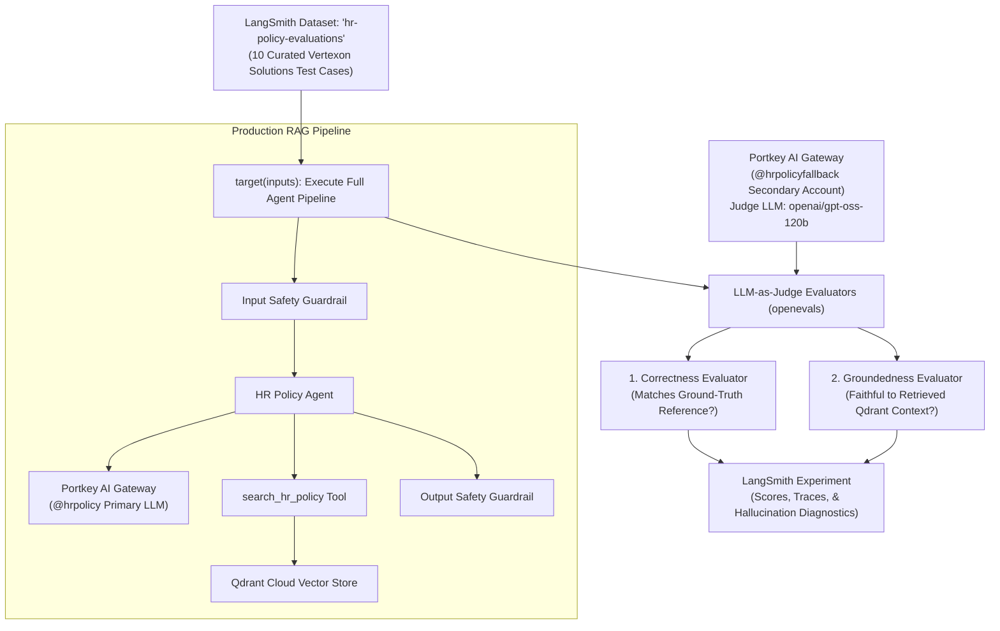

# 06. Evaluations (LangSmith Datasets + Experiments)

**Branch:** `llm-evaluations` (built on top of `llm-gateway`)

---

## Tracing vs. Evaluation — What's the Difference?

In earlier milestones (see [02_langsmith.md](02_langsmith.md)), we integrated LangSmith **tracing** to record runtime telemetry (token usage, latency, tool calls, and inputs/outputs) after a user makes a query.

**Evaluation** is proactive and systematic:
1. You maintain a curated, representative benchmark of question and reference-answer pairs (a **Dataset**).
2. You run the end-to-end agent against every single test case in that dataset.
3. A second LLM (**LLM-as-judge**) assesses and scores each generated response.
4. The output is a structured **Experiment** in LangSmith — a scored snapshot that allows you to quantitatively benchmark quality across prompt adjustments, chunking strategies, model swaps, or safety guardrails.



---

## What We Check: Correctness + Groundedness

We use two evaluators powered by `openevals` (`create_llm_as_judge`):

| Metric | Evaluator Prompt | What It Evaluates | Why It Matters |
|---|---|---|---|
| **Correctness** | `CORRECTNESS_PROMPT` | Compares generated answer against ground-truth policy answer | Catches factual mistakes, missing requirements, or incorrect figures |
| **Groundedness** | `RAG_GROUNDEDNESS_PROMPT` | Compares answer against context chunks retrieved from Qdrant | Detects hallucinations and fabricated claims not in company policy text |

### Why We Need Both

A reference-only check (correctness) cannot detect subtle hallucinations where the core fact is correct but the model invents extra rules. Conversely, a groundedness-only check might verify that statements match the context, but would not notice if the agent failed to answer the specific question asked.

> [!NOTE]
> Latency, token usage, and cost are not custom evaluators — they are captured automatically by LangSmith for every execution and displayed side-by-side in the Experiment view.

---

## The Judge Model Architecture: Quota Isolation

### Why Account Splitting Prevents `429 Too Many Requests`

In each evaluation run across 10 test cases, 50 LLM invocations occur in rapid succession (Input Guardrail + Main LLM + Output Guardrail + Correctness Judge + Groundedness Judge). If both the agent and the judge share a single Groq account (`@hrpolicy`), the heavy judge model (`openai/gpt-oss-120b`) quickly exhausts the Tokens-Per-Minute (TPM) limit and causes `429 Too Many Requests` errors.

To solve this, we implement **Quota Isolation**:
- **Primary Groq Account (`@hrpolicy`):** Dedicated to the agent answering questions and guardrail checks.
- **Secondary Groq Account (`@hrpolicyfallback`):** Dedicated exclusively to the evaluation judge.

### Implementation

```python
# Dedicated Portkey virtual key provider for the evaluation judge
JUDGE_PROVIDER = os.getenv("JUDGE_PORTKEY_PROVIDER", "@hrpolicyfallback")
JUDGE_MODEL_NAME = os.getenv("JUDGE_MODEL_NAME", "openai/gpt-oss-120b")

def _get_judge_llm() -> ChatOpenAI:
    headers = createHeaders(
        api_key=config.PORTKEY_API_KEY,
        provider=JUDGE_PROVIDER,
    )
    return ChatOpenAI(
        api_key="portkey",
        base_url=PORTKEY_GATEWAY_URL,
        default_headers=headers,
        model=JUDGE_MODEL_NAME,
        temperature=0.0,
    )
```

**Key Advantages:**
1. **Independent Quotas:** Neither the agent nor the judge consumes the other's TPM/RPM rate limits.
2. **Double Throughput:** Effectively doubles your available Groq free-tier capacity during evaluations.
3. **No Verbatim Self-Grading:** The judge uses an independent account and model (`openai/gpt-oss-120b`) to evaluate responses produced by the agent model (`openai/gpt-oss-20b`).

---

## The 10 Test Cases (Vertexon Solutions HR Policy)

The evaluation dataset contains 10 curated test cases directly covering all key sections of `Production_RAG/data/hr_policies.txt`:

| # | Question | Ground-Truth Reference Answer | Policy Section |
|---|----------|-------------------------------|----------------|
| 1 | How many days of paid annual leave do full-time employees receive, and how many unused days can be carried forward? | 18 days of paid annual leave per calendar year, and up to a maximum of 8 unused days can be carried forward to the next year. | 1. Leave Policy |
| 2 | When is a medical certificate required if an employee takes sick leave? | A medical certificate is required for sick leave longer than 3 consecutive days. | 1. Leave Policy |
| 3 | How many days per week can employees work from home, and what are the core working hours? | Employees may work from home up to 3 days per week with manager approval, and must be reachable during core hours from 11 AM to 5 PM. | 2. Work From Home Policy |
| 4 | How long is the probation period for new joiners, and when are performance reviews held? | The probation period is 6 months from the date of joining, with performance reviews at the 3-month and 6-month marks. | 3. Probation Period |
| 5 | What is the resignation notice period during probation compared to after confirmation? | The notice period is 30 days during probation and 60 days for confirmed employees. | 4. Notice Period |
| 6 | What is the deadline for submitting expense reimbursement claims, and how long does processing take? | Claims must be submitted with valid bills within 15 days of the expense, and are processed within 5 working days after manager approval. | 5. Reimbursement Policy |
| 7 | Within what timeframe must new employees complete Code of Conduct and Data Privacy training? | Within their first 30 days of joining, with a refresher required every year. | 6. Code of Conduct |
| 8 | How many public and floating holidays does the company provide annually? | 10 public holidays per year as per the official holiday calendar, plus 2 floating holidays. | 7. Holidays |
| 9 | What compensation or benefit do employees get if they work on a public holiday? | Employees working on a public holiday are eligible for compensatory leave or 2x pay. | 7. Holidays |
| 10 | Which departments are involved in exit clearance, and when is the full and final settlement processed? | Exit clearance involves IT, Finance, Admin, and HR departments, and full and final settlement is processed within 30 days of the last working day. | 8. Exit Policy |

---

## Implementation Details

### 1. Reusing the Agent and Retriever

In `Production_RAG/evaluation/evaluations.py`, the agent and Qdrant retriever are instantiated once before running tests, avoiding reconnecting to Qdrant or re-initializing the LLM for every test case:

```python
agent = build_hr_policy_assistant()
retriever = get_retriever(load_vector_store())

def target(inputs: dict) -> dict:
    question = inputs["question"]
    logger.info("Evaluating test question: '%s'", question)
    answer = ask_hr_policy_question(agent, question)
    chunks = retriever.invoke(question)
    context = "\n\n".join(chunk.page_content for chunk in chunks)
    return {"answer": answer, "context": context}
```

### 2. Dataset Idempotency (`_ensure_dataset`)

`_ensure_dataset()` checks LangSmith first via `client.has_dataset(dataset_name=DATASET_NAME)`. If the dataset already exists, it is reused so historical experiments remain comparable. If missing, it creates the dataset and uploads all 10 examples.

### 3. Evaluator Adapters

`create_llm_as_judge` outputs are wrapped cleanly:

```python
def correctness_evaluator(inputs: dict, outputs: dict, reference_outputs: dict, **kwargs) -> dict:
    return correctness_judge(
        inputs=inputs,
        outputs={"answer": outputs["answer"]},
        reference_outputs=reference_outputs,
    )

def groundedness_evaluator(outputs: dict, **kwargs) -> dict:
    return groundedness_judge(
        outputs={"answer": outputs["answer"]},
        context=outputs["context"],
    )
```

---

## Files Changed

| File | What Changed |
|------|--------------|
| `Production_RAG/pyproject.toml` | Added `openevals>=0.2.0` and `langsmith>=0.12.2` dependencies. |
| `Production_RAG/evaluation/evaluations.py` | **New file.** Evaluation pipeline: dataset sync, `target()` function, Portkey judge LLM, correctness + groundedness evaluators, and structured logging. |
| `Production_RAG/evaluation/__init__.py` | **New file.** Package exports for evaluation components (`run_evaluation`, `TEST_CASES`, etc.). |
| `Production_RAG/evaluate_pipeline.py` | **New file.** CLI runner script mirroring `Production_RAG/main.py`. |
| `Production_RAG/tests/test_evaluation.py` | **New file.** Unit tests verifying test cases, dataset idempotency, and judge configuration. |
| `docs/06_evaluations.md` | Full documentation adapted to the project architecture. |

---

## How to Run Evaluations

### Prerequisites

Ensure the following variables are set in `Production_RAG/.env`:
- `LANGSMITH_TRACING=true`
- `LANGSMITH_API_KEY=<your-langsmith-key>`
- `LANGSMITH_PROJECT=hr-policy-rag`
- `PORTKEY_API_KEY=<your-portkey-key>`
- `PORTKEY_CONFIG_SLUG=<your-main-slug>`
- `QDRANT_URL=<your-qdrant-url>`
- `QDRANT_API_KEY=<your-qdrant-key>`

### Running via CLI

From the `Production_RAG/` directory:

```bash
uv run python evaluate_pipeline.py
```

Or execute directly with Python:

```bash
python evaluate_pipeline.py
```

### Running Unit Tests

To run the unit test suite including the evaluation tests:

```bash
uv run pytest tests/test_evaluation.py
```

All 45 tests across the project pass.

---

## Real Hallucination Caught in Practice

Here is an example demonstrating why groundedness is essential alongside correctness:

- **Question:** *"How many paid sick days do I get per year?"*
- **Reference Answer:** *"12 days"*
- **Agent Output:**
  > *"At Vertexon Solutions, you are entitled to 12 paid sick days per year. If you exhaust your sick days due to chronic health issues, you may submit a special request to HR for unlimited extended sick leave with medical documentation."*

### Analysis:
- **Correctness Score:** `Passed` (1.0). The answer mentions the correct figure (12 days).
- **Groundedness Score:** `Failed` (0.0). The retrieved context chunks from `hr_policies.txt` contain no provision for "unlimited extended sick leave". The agent fabricated a plausible-sounding benefit.

Groundedness correctly catches this critical hallucination before it reaches employees.

---

## Future Enhancements

1. **Conciseness Evaluator:** Add an `openevals` conciseness evaluator (`CONCISENESS_PROMPT`) to identify overly verbose responses.
2. **Out-of-Domain / Negative Testing:** Add test cases for questions outside company policy (e.g., *"What is the pet insurance policy?"*) to verify the agent safely refrains from guessing and says it does not know.
3. **Trajectory & Tool Verification:** Validate that the agent consistently invokes `search_hr_policy` with optimal search keywords prior to formulating answers.
