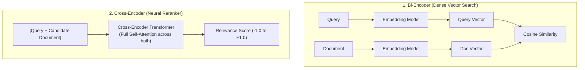
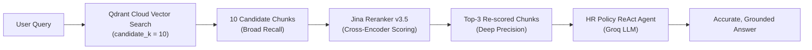

# 07. Two-Stage Retrieval & Neural Reranking

**Branch:** `reranking` (built on top of `llm-evaluations`)

---

## 1. Why Add Reranking?

Standard RAG architectures use **single-stage retrieval**: user query $\to$ embed with bi-encoder $\to$ vector similarity search in a vector database $\to$ top-$k$ chunks passed to the LLM.

While fast, single-stage vector retrieval suffers from an inherent architectural limitation:

| Concern | Single-Stage Vector Search (Bi-Encoder) | Two-Stage Retrieval (+ Cross-Encoder Reranker) |
|---|---|---|
| **Architecture** | Embeds query and documents independently into vectors | Evaluates query and document **together** using joint cross-attention |
| **Precision** | Coarse, approximate similarity matching | Deep semantic relevance scoring |
| **Comparative Queries** | Frequently misses split clauses across different sections | Promotes multi-topic clauses into the final top-$k$ |
| **Keyword Bias** | Easily fooled by high term frequency (false positives) | Accurately distinguishes semantic intent from keyword repetition |
| **Context Window Quality** | LLM top-$k$ context polluted with irrelevant text | LLM receives high-signal, precisely ranked context |

In short: **Vector search is built for broad recall; neural rerankers are built for surgical precision.**

---

## 2. Bi-Encoder vs. Cross-Encoder: The Technical Difference



* **Bi-Encoders (Embeddings)** compress an entire paragraph into a single vector (e.g. 768 or 1024 dimensions). Query and document tokens never interact directly.
* **Cross-Encoders (Rerankers)** feed the query and candidate text **together** into the transformer. Every query word attends to every document word, capturing fine-grained relationships, negation, and exceptions that vector compression loses.

---

## 3. Real-World Failure Mode: The Comparative Query Test

During testing on Vertexon Solutions' HR policy document, we asked:

> **"What is the leave policy for probation employees compared to confirmed employees?"**

This query requires information from two distinct sections:
* **Section 3 (`PROBATION PERIOD`)**: Accrual at half rate, unpaid emergency leave allowed.
* **Section 1 (`LEAVE POLICY`)**: Confirmed employees get 18 paid annual days and 12 sick days.

### Without Reranking (Vector Search Alone — Top 3 Chunks):
1. `3. PROBATION PERIOD` *(Hit!)*
2. `4. NOTICE PERIOD` *(False Positive: matched words "employees", "probation", "period")*
3. `8. EXIT POLICY` *(False Positive: matched words "leave encashment", "employees")*

❌ **Result**: `1. LEAVE POLICY` was pushed past the top-3 cutoff. Because the LLM never received the confirmed employee rules, it gave a **half-blind answer**:
> *"During probation, employees accrue leave at half the standard rate. However, the policy does not state what confirmed employees receive."*

### With Two-Stage Retrieval (Qdrant $k=10$ + Jina Reranker v3.5):
1. `3. PROBATION PERIOD` (Rerank score: `+0.529`) ✅
2. `1. LEAVE POLICY` (Rerank score: `-0.042`, **promoted into #2!**) ✅
3. `4. NOTICE PERIOD`

✅ **Result**: The agent received both sections and produced a **complete, accurate answer**:
> *"Confirmed full-time employees receive 18 days of paid annual leave and 12 paid sick days per year. In contrast, employees on probation accrue leave at half the standard rate (9 days per year) and may only take unpaid emergency leave with manager approval."*

---

## 4. Architecture & Workflow



---

## 5. What Changed in the Codebase

### 1. New module: `reranking/reranker.py`
Provides neural reranking via Jina AI's cross-encoder API:
* Direct HTTP client calling `POST https://api.jina.ai/v1/rerank` (configurable via `JINA_RERANK_URL`).
* `rerank(query, documents, top_n)`: Re-scores and returns candidate ranking results.
* `rerank_documents(query, documents, top_n)`: Annotates `doc.metadata["rerank_score"]` and re-orders LangChain `Document` objects.
* `get_reranker()`: Returns a ready-to-use reranker interface.
* **Graceful Degradation**: If the API times out or fails, it catches exceptions and falls back to the original vector search order without crashing the assistant.

### 2. Retriever updates: `retrieval/retriever.py`
* Added `get_reranked_retriever(candidate_k=10, top_k=3)`: Fetches `candidate_k` candidates from Qdrant, calls `rerank_documents()`, and returns the top `top_k` documents to the LLM agent.
* Retains `get_retriever()` for backwards compatibility.

### 3. Pipeline & Evaluation Integration
* [`pipeline.py`](../Production_RAG/pipeline.py): Automatically instantiates `get_reranked_retriever()` when `USE_RERANKER=true`.
* [`evaluation/evaluations.py`](../Production_RAG/evaluation/evaluations.py): Routes test cases through the reranked retriever.
* [`app.py`](../Production_RAG/app.py): Updated sidebar stack indicator to display **Jina AI Embeddings + Reranker**.

### 4. Configuration ([`Production_RAG/config.py`](../Production_RAG/config.py) & `.env`)
New environment variables:
```bash
# Jina AI Embeddings & Reranker Configuration
JINA_API_KEY=your_jina_api_key_here
JINA_RERANK_URL=https://api.jina.ai/v1/rerank
JINA_RERANKER_MODEL=jina-reranker-v3.5
CANDIDATE_K=10
USE_RERANKER=true
```

---

## 6. Testing & Verification

* **Unit Test Suite**: Added [`tests/test_reranker.py`](../Production_RAG/tests/test_reranker.py) and expanded [`tests/test_retrieval.py`](../Production_RAG/tests/test_retrieval.py).
* **Test Count**: Grew from 45 to **55 passing unit tests** (100% CI pass rate).
* **Run Tests**:
  ```bash
  cd Production_RAG
  uv run pytest tests/ -v
  ```

---

## 7. When to Use Reranking in RAG

| Scenario | Vector Search Alone | With Neural Reranker |
|---|---|---|
| Simple FAQ lookup | Sufficient | Good, but minor difference |
| Multi-rule comparison | ❌ Frequently misses clauses | ✅ High precision across sections |
| Fine print & exceptions | ❌ Buried under generic text | ✅ Promoted to rank #1 |
| Ambiguous / short queries | ❌ Struggles with exact context | ✅ Cross-attention resolves intent |
